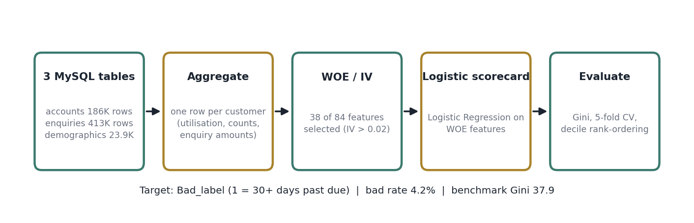
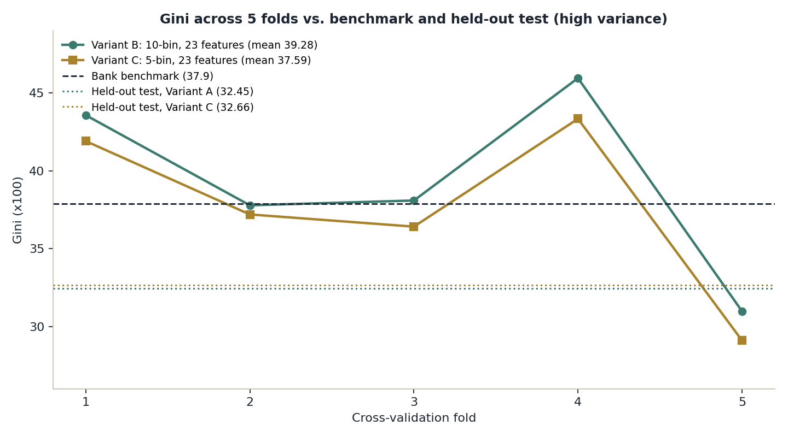
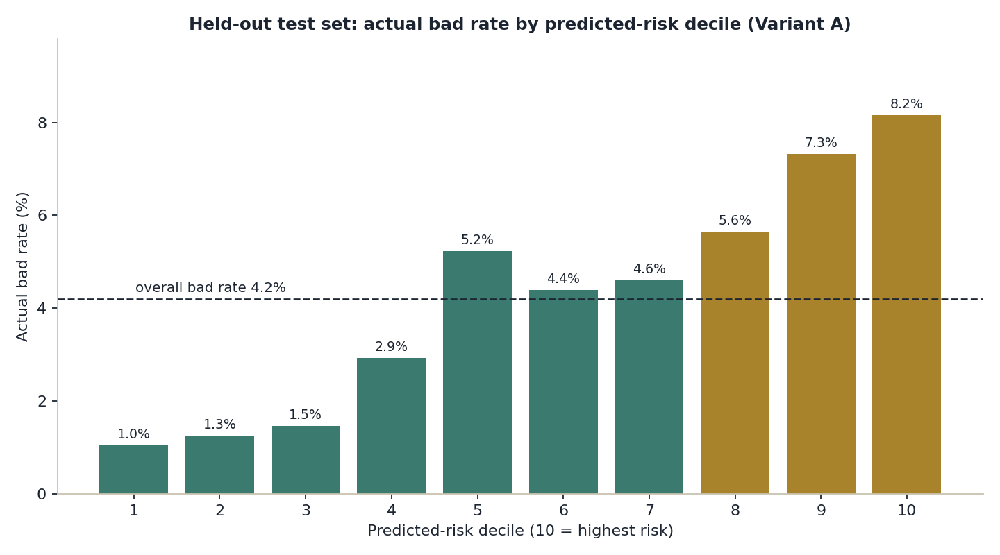
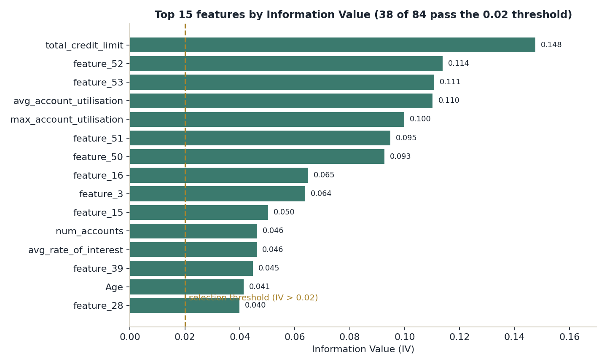
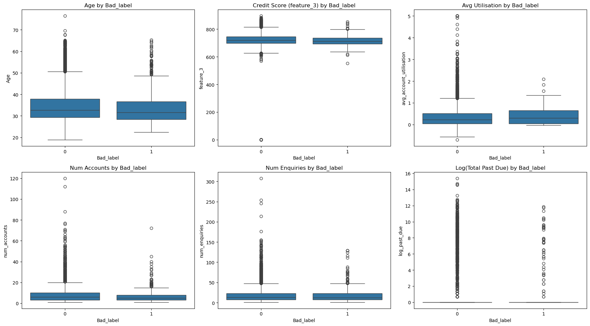

# Credit Risk Scorecard (WOE / IV + Logistic Regression)

Predicts which credit-card customers will become **30+ days past due** (`Bad_label`) using three joined MySQL tables, and compares the result with a bank's existing model (**Gini 37.9**). Built with Python, SQL, pandas and scikit-learn as part of a data science mentoring programme.



## Key results

| Variant | Features | WOE bins | 5-fold CV Gini (training split) | Held-out test Gini |
|---|---|---|---|---|
| A (saved model) | 38 | 10 | not computed | 32.45 |
| B | 23 (after correlation pruning) | 10 | **39.28** (std 5.21) | not computed |
| C | 23 | 5 | 37.59 (std 5.01) | 32.66 |
| Bank benchmark | n/a | n/a | 37.9 | 37.9 |

**Honest summary:** cross-validation for Variant B is above the benchmark, but held-out test scores for Variants A and C are below it, and fold-to-fold spread (31 to 46 Gini) is larger than the margin. Only 4.2% of customers are bad (1,004 of 23,896), so a single split is noisy. **I do not claim a reliable improvement over the benchmark.** What the model does show is useful risk ranking: on the held-out test set, the top predicted-risk decile has an **8.2%** bad rate vs **1.0%** in the bottom decile, and the top three deciles contain about **50%** of all bad customers.





## Approach

1. **Load** three MySQL tables with SQLAlchemy: account history (186,329 rows), credit enquiries (413,188 rows) and customer demographics with the target (23,896 customers).
2. **Clean:** parse dates and numerics, treat blank strings as missing, derive Age, drop identifier-like and extremely sparse (95%+ missing) columns.
3. **Aggregate to one row per customer** (account counts, balances, past-due amounts, per-account credit utilisation, enquiry counts and amounts) *before* joining, so the target is never duplicated. Row counts were verified (23,896 in, 23,896 out).
4. **Select features with Information Value:** 38 of 84 candidates have IV > 0.02. A bug where high-cardinality categoricals produced IVs up to 5.99 was fixed by grouping rare categories (max IV after the fix: 0.15).
5. **Transform to WOE** (fitted on the training split only) and fit an interpretable **Logistic Regression** scorecard.
6. **Evaluate** with Gini (2 x AUC - 1), 5-fold stratified cross-validation and decile rank-ordering.





## Limitations (stated up front)

* IV feature selection used all customers before the split, and WOE was fitted on the full training split before cross-validation, so validation scores are slightly optimistic.
* No cross-validation for the 38-feature model and no held-out score for the 23-feature 10-bin model.
* Single random split; no out-of-time validation, calibration check or stability analysis.
* Only Logistic Regression was evaluated (no tree-based comparison).
* The 79 demographic features are anonymised; their meanings are inferred from value patterns.

## Repository contents

```
credit_risk_scorecard.ipynb   full analysis with saved outputs
images/                       figures used in this README
requirements.txt
```

## Running it yourself

The data lives in a private training database and is **not** included, and no credentials are stored in this repo. To re-run the notebook against your own copy of a database with the same three tables, set these environment variables first:

```
DB_HOST, DB_PORT, DB_USER, DB_PASSWORD, DB_NAME
```

```bash
pip install -r requirements.txt
jupyter notebook credit_risk_scorecard.ipynb
```

All outputs are already saved in the notebook, so you can read the full analysis on GitHub without running anything.

## Tech stack

Python, SQL (MySQL via SQLAlchemy and PyMySQL), pandas, NumPy, scikit-learn, matplotlib, seaborn.
